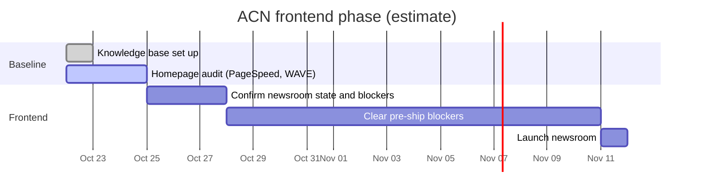

# Status

Last updated: 2026-10-22.

Newest items at the top of each list. Tick items off (`[x]`) and add the date; never delete them.

Honest note: where things stand on several workstreams is **hard to tell** (Kris, 2026-10-22). Items marked "to confirm" need checking, not guessing.

## Timeline

Rough estimate; no dates agreed yet.

## Checklist

### To do

- [ ] Change the passwords pasted into chat on 2026-10-22, one per account, 2FA on ([map/accounts.md](../map/accounts.md))
- [ ] Make this repo private again
- [ ] Pick a password manager ([decision 0002](../decisions/0002-credentials.md))
- [ ] Run PageSpeed Insights and WAVE on www.acnnewswire.com, add screenshots to [research](../research/2026-10-22-homepage-accessibility-structure.md)
- [ ] Confirm newsroom state: which repo is main, what is deployed where, the pre-ship blocker list ([systems/newsroom.md](../systems/newsroom.md))
- [ ] Decide on cheap accessibility fixes to the live site ([research](../research/2026-10-22-homepage-accessibility-structure.md#what-this-means-for-the-project))
- [ ] To confirm: portal status after the Sep 14 deadline ([systems/portal.md](../systems/portal.md))
- [ ] Benchmark Business Wire and the other competitors the same way ([client/competitors.md](../client/competitors.md))

### Done

- [x] 2026-10-22 Homepage accessibility and structure scan ([research](../research/2026-10-22-homepage-accessibility-structure.md))
- [x] 2026-10-22 Knowledge base set up from the client template ([log](../logs/2026-10-22-knowledge-base-set-up.md))
- [x] Sep 2026 Homepage slowness and app pool outages fixed ([systems/legacy-site.md](../systems/legacy-site.md#history))
- [x] Aug 2026 Newsroom moved to the new API (`development.acnnewswire.com`) ([systems/newsroom.md](../systems/newsroom.md))
- [x] Aug 2026 Legacy database exported, cleaned and analysed ([systems/database.md](../systems/database.md))
